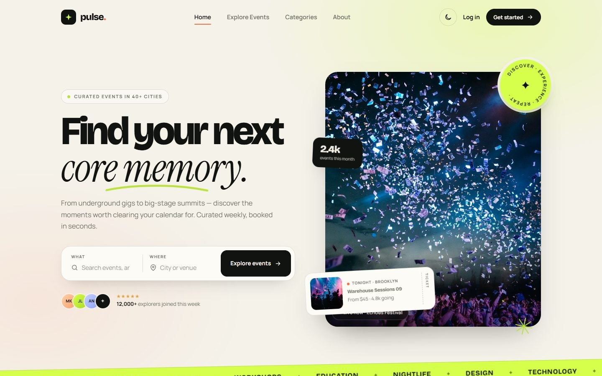

# AK — Event Discovery Website

AK is a simple event discovery website made for the Day 01 frontend assignment. It helps users find concerts, conferences, workshops, sports events and more in one place.

The website is built with only **HTML, CSS and JavaScript**. It does not need a server, database or any framework — you can open `index.html` directly in a browser.



<p align="center">
  
</p>

---

## What the Website Includes

- **Navigation bar** — Home, Events, Categories and About scroll to their sections. Login opens a login form and Get Started opens a signup form. Glassmorphism effect and scroll shadow.
- **Hero section** — a short introduction with gradient background, live event-name search, location search and a search button.
- **Featured Events** — 6 event cards with CSS Grid layout, image hover zoom, category badge, favourite button, event details and responsive card design.
- **Categories** — Technology, Music, Business, Sports, Workshops and Education. Clicking a category filters the events with smooth hover effects.
- **Trending Now** — 3 popular events shown with rank badges and trending indicators.
- **About section** — a short explanation of what AK offers with improved typography and spacing.
- **Newsletter** — an email form that checks for empty or invalid emails before showing a success message.
- **Footer** — social links, quick links and contact details.

## Main Features

- **Live search by event name** — results update as you type (300ms debounce).
- **Category-based filtering** — filter events by Technology, Music, Business, Sports, Workshops or Education.
- **City/venue search** — works together with category and name filters.
- **Dynamic "no events found" message** — shows which filters are active when no results match.
- Favourite (heart) button that saves events in `localStorage`.
- A **Saved** filter to show only favourited events.
- Event details popup with description, date, location and price.
- Registration form with validation for name, email, mobile number and number of tickets.
- Login form and Signup form with email, password and name validation.
- **Clear Filters** button to reset all active filters.
- **Fully responsive layout** — optimized for desktop, tablet and mobile with proper breakpoints.
- Mobile hamburger menu with smooth transitions.
- **Modern UI/UX** — CSS Grid cards, smooth hover effects, shadows, glassmorphism, and polished transitions.

## Technologies Used

- **HTML5** — semantic page structure with accessibility attributes.
- **CSS3** — CSS Grid for card layouts, Flexbox, custom properties (CSS variables), gradients, backdrop-filter, transitions, and responsive media queries.
- **JavaScript (ES5)** — event data, DOM rendering, live search with debouncing, category filtering, favourites management, popup modals and form validation.

## Folder Structure

```text
Event Dictionery/
├── index.html
├── css/
│   └── style.css
├── js/
│   └── app.js
├── images/                 # Event photos and the AK logo icon
├── screenshots/
└── README.md
```

## How to Run

1. Download or copy the project folder.
2. Open `index.html` in any browser.

That's it — no installation or server is required. If you use VS Code, you can also open it with the **Live Server** extension.

## How It Works

All event information is stored in two arrays inside `js/app.js`: `events` (6 featured events) and `trending` (3 events). JavaScript builds the cards from this data using CSS Grid, applies the active category and search terms, and re-renders the grid dynamically.

### Live Search
Search inputs have debounced event listeners (300ms delay) that filter events as you type. The search looks through event title, category, venue and location fields. You can also submit the search form explicitly to jump to the events section.

### CSS Grid Layout
Event cards use `display: grid` with `grid-template-rows: auto 1fr` to ensure the card footer always stays at the bottom regardless of content length. The cards have hover effects including translateY, box-shadow transitions, and image zoom.

### Filtering
The category filter buttons and saved events button work together with search. When multiple filters are active, events must match all criteria. The "no events found" message dynamically lists which filters are active.

### Favourites
The favourite buttons save event ids in `localStorage` under the key `akFavorites`. The heart icon fills with color when active, and the saved count updates in real-time.

### Modals
The details popup is a hidden `<div>` that is filled with the selected event's data and shown with an `open` class. Clicking **Register Now** opens a registration form inside the same popup. It validates the full name, email, 10-digit Indian mobile number and ticket count, shows field-specific errors, and displays a confirmation message when valid.

### Authentication
The **Login** button opens a login form, and **Get Started** opens a signup form in a shared popup. Both validate email and password; signup also checks the name and that passwords match. The logged-in user is stored in `localStorage` under `akUser`, and the Login button changes to Logout.

### Responsive Design
The layout uses CSS Grid with responsive breakpoints at 992px, 900px, 768px, 576px and 400px. The grid adjusts from 3 columns on desktop to 2 on tablet and 1 on mobile. The navigation collapses into a hamburger menu on mobile devices.

## Recent Updates (November 2026)

### Task 1: Layout Improvements
- Redesigned event cards using CSS Grid with proper structure and hover effects
- Enhanced navbar with glassmorphism backdrop-filter and scroll shadow effect
- Improved hero section with gradient background and decorative radial accent
- Polished all cards (event, trending, category) with consistent shadows and transitions
- Refined responsive breakpoints for better mobile and desktop experience

### Task 2: JavaScript Enhancements
- Added live search functionality that updates results as you type (debounced)
- Enhanced category-based filtering with better visual feedback
- Dynamic "no events found" messages showing active filters
- Added header scroll effect that applies shadow when scrolling

## Note

The Poppins font is loaded from Google Fonts. If there is no internet connection, the website automatically falls back to Arial and everything else still works.
