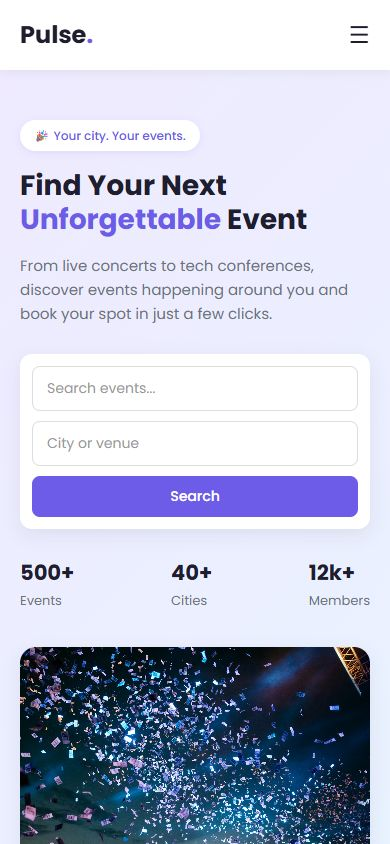

# Pulse — Event Discovery Website

A simple, responsive event discovery website made for **Day 01** of my frontend assignment. Pulse lets you search events, browse categories, save favourites and see event details in a popup.

It is a **pure static website** — HTML, CSS and JavaScript only. There is no server, database, framework or build step. You can open `index.html` directly in a browser.


---

## Preview

### Desktop


### Mobile

<p align="center">
  
</p>

Full-page screenshots are also included:

- `screenshots/desktop.jpg` — full desktop page (1440 px)
- `screenshots/mobile.jpg` — full mobile page (390 px)

---

## About the project

Pulse is a single-page website with these sections:

1. Sticky navigation bar
2. Hero section with a search form
3. Featured events grid
4. Browse by category
5. Trending events
6. About section
7. Newsletter signup
8. Footer

All event cards are created with JavaScript from an array of event objects, so the page is not just repeated HTML.

---

## Features

- **Navigation** — Home, Events, Categories, About, Login and Get Started. All section links scroll to the correct part of the page.
- **Mobile menu** — on small screens the links move into a hamburger menu.
- **Hero search** — search by event name and by city/venue. Both fields work together.
- **6 featured event cards** — each card has an image, name, date, time, venue, city, category and a **View Details** button.
- **Category filtering** — All, Technology, Music, Business, Sports, Workshops, Education.
- **Category cards** — clicking one filters the event grid and scrolls to it.
- **3 trending cards** — ranked list with a different dark style.
- **Favourites** — the heart button saves an event in `localStorage`, and the **Saved** filter shows only saved events.
- **Event details popup** — shows the event image, description, date, location and price. Close it with the X button, by clicking the dark background, or with the Escape key.
- **Newsletter validation** — empty and invalid emails show an error; a valid email shows a success message.
- **Empty state** — if nothing matches a search, a message and a **Clear Filters** button appear.
- **Responsive layout** — works on desktop, tablet and mobile using Flexbox, CSS Grid and media queries.

---

## Folder structure

```text
day-01-event-discovery-platform/
├── index.html              # All page sections
├── css/
│   └── style.css           # Styling and media queries
├── js/
│   └── app.js              # Event data and all JavaScript
├── images/                 # 11 local event photos
├── screenshots/
│   ├── desktop.jpg         # Full desktop page
│   ├── mobile.jpg          # Full mobile page
│   ├── preview-desktop.jpg # Desktop preview
│   └── preview-mobile.jpg  # Mobile preview
└── README.md
```

> For submission, name the project folder **`day-01-event-discovery-platform`**.

---

## How to run

### Option 1 — open the file

Double-click `index.html`, or right-click it and choose **Open with → Google Chrome**.

Everything works from the filesystem (`file://`), including filters, favourites and the popup. The only thing that needs internet is the Poppins font from Google Fonts; without internet it falls back to Arial.

### Option 2 — Live Server

Open the folder in VS Code, right-click `index.html` and choose **Open with Live Server**.

### Option 3 — any static server

```bash
python -m http.server 5500
```

Then open <http://localhost:5500>.

---

## How it works

### 1. Event data

`js/app.js` starts with two arrays:

- `events` — the 6 featured events (`e1`–`e6`)
- `trending` — the 3 trending events (`t1`–`t3`)

Each object stores an id, title, category, date, time, venue, location, price, image and description. To add a new event, I only add one object to the array.

### 2. Rendering

`renderEvents()` filters the `events` array and builds the cards with template strings. `renderTrending()` does the same for the trending section. The HTML already contains the section containers; JavaScript fills them in.

### 3. Filtering and search

The page keeps four pieces of state:

```js
let currentCategory = "all";
let searchTerm = "";
let locationTerm = "";
let showSaved = false;
```

`getFilteredEvents()` checks the category, the search text, the location and the saved-only state. The same function is used by the filter buttons, the search form and the category cards, so there is only one filtering path.

### 4. Favourites

Favourites are stored as an array of event ids under the `localStorage` key `pulseFavorites`. Heart clicks are handled with event delegation on the document, so buttons still work after the grid is re-rendered.

### 5. Event popup

The popup is a normal `<div class="modal">` overlay, not a separate page. `openModal(id)` finds the event in the combined array, fills the popup fields and adds an `open` class. The body scroll is locked while it is open.

### 6. Form validation

The newsletter form uses a simple regular expression:

```js
/^[^\s@]+@[^\s@]+\.[^\s@]+$/
```

It checks for an empty field first, then the pattern, and finally shows a success message and resets the form.

---

## Responsive behaviour

| Width | Layout |
| --- | --- |
| Above 992 px | 3-column event, category and trending grids; 4-column footer |
| 992 px and below | Grids become 2 columns; footer becomes 2 columns |
| 900 px and below | Hero stacks into one column |
| 768 px and below | Navigation becomes a hamburger menu; search fields stack; trending is 1 column |
| 576 px and below | Event cards become 1 column; newsletter stacks; footer becomes 1 column |
| 400 px and below | Category cards become 1 column |

I checked the page at **1440, 1280, 1100, 1024, 980, 900, 820, 768, 720, 600, 480, 390 and 360 px** and there was no horizontal scrolling at any width.

---

## Testing

What I tested in the browser:

- All 6 event cards and 3 trending cards appear on load.
- Category buttons show only the matching events.
- Searching an event name works (for example, `neon`).
- Searching a city/venue works (for example, `london`).
- Favourites are saved after reload and the Saved filter works.
- The details popup opens for both featured and trending events and closes correctly.
- Newsletter shows separate messages for an empty email, an invalid email and a valid email.
- The mobile menu opens and closes at 390 px.
- All 11 images load with no broken links.
- No JavaScript console errors.
- The whole site also works when opened directly with `file://` (no server).

---

## What I learned

- How to render cards from a JavaScript array instead of writing every card in HTML.
- How to combine several filter conditions in one function.
- How CSS Grid and Flexbox can be used together for page sections and card layouts.
- How media queries change the same layout for tablet and mobile.
- How `localStorage` can keep small pieces of data after a page refresh.
- How event delegation keeps dynamic buttons working after re-rendering.
- How to validate an email address with JavaScript before submitting a form.

---

## Credits

- **Font:** [Poppins](https://fonts.google.com/specimen/Poppins) from Google Fonts.
- **Images:** demo event photos stored locally in the `images/` folder.
- **Code and design:** original work for the Day 01 assignment. All event names, venues and prices are fictional.

---

## Submission checklist

- [x] Navigation with Home, Events, Categories, About, Login and Get Started
- [x] Hero with event-name and location search
- [x] 6+ featured event cards with image, name, date, time, location and category
- [x] View Details button on every event card
- [x] 6 categories with working filtering
- [x] Working event-name search
- [x] 3 distinct trending cards
- [x] Newsletter form with email validation
- [x] Footer with social links, quick links and contact details
- [x] Flexbox and CSS Grid used in the layout
- [x] Responsive media queries for desktop, tablet and mobile
- [x] JavaScript DOM manipulation and event handling
- [x] Desktop and mobile screenshots included
- [x] Works without a server by opening `index.html`
