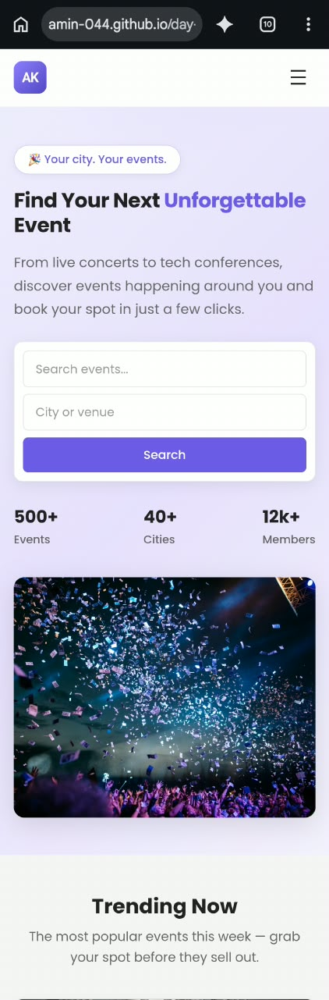

# AK - Event Discovery Website

Hey! This is **AK**, a small event discovery website I built for my frontend assignment. The idea is simple: instead of checking ten different sites, you can find concerts, conferences, workshops, sports events and more all in one place.

I used only **HTML, CSS and JavaScript** — no framework, no server, no database. Just open `index.html` in a browser and it works.

## Screenshots




Want to see the whole page? [Here is the full desktop screenshot](screenshots/newdesktop.jpg).

---

## What you can do on this site

**Finding events**

- Search events by name — results change while you type
- Search by **city or venue**
- Filter by category: Technology, Music, Business, Sports, Workshops and Education
- Sort by price (low to high or high to low)
- See how many events are left after filtering
- Save events with the heart button and view them with the **Saved** button
- Open **View Details** — the last 3 events you open appear in **Recently Viewed**

**Booking events**

- Log in first, then register — the form fills your name and email automatically
- See a **booking summary** (ticket price × quantity = total) before confirming
- Every booking starts with a **Confirmed** status
- See all bookings in a **table** (booking ID, event, date/time, tickets, amount, status, actions)
- **Edit** a booking, **cancel** it, or **delete** it
- Search bookings by event name and filter by status (All / Confirmed / Cancelled)
- **Export** the bookings you are looking at to a CSV file that opens in Excel
- Custom confirmation popup for cancel and delete

**Dashboard**

- Total bookings, upcoming events, cancelled bookings and total amount spent
- Recently viewed events
- Everything updates automatically after every change

**Other**

- Login / Signup forms (practice only, data stays in the browser)
- Newsletter form with email checking
- Hamburger menu on mobile, fully responsive
- Cool scroll effect: sections stack like cards, cards fade in, and a thin progress bar shows how far down you are

## How to run it

1. Download or copy this folder.
2. Open `index.html` in Chrome (or any browser).

That's it, nothing to install. If you are using VS Code, you can also use the **Live Server** extension.

## Files in this folder

```text
Event Dictionery/
├── index.html          all the sections of the page
├── css/
│   └── style.css       styling, layout and media queries
├── js/
│   └── app.js          event data + all the JavaScript
├── images/             event photos, hero images and the logo
├── screenshots/        screenshots of the website
└── README.md           this file
```

## How I made it (brief explanation)

All the events are stored as objects in an array inside `app.js`. JavaScript turns that array into event cards, so I did not have to write every card in HTML. When you type in the search box or click a category, I filter the array and render the cards again.

For search I used a small delay (300ms debounce) so the filtering does not run on every single keystroke. Favourites, recently viewed events, the logged-in user and bookings are all saved in `localStorage`, so they are still there after you close the browser. I wrapped the storage calls in `try...catch` so the page does not break if a browser blocks storage. The popups are just hidden `div`s that get an `open` class when you click a button.

For the design I used CSS Grid for the cards, Flexbox for alignment, CSS variables for colours and media queries for tablet and mobile sizes. The navbar has a glass kind of effect using `backdrop-filter`, and it gets a shadow when you scroll.

### About the booking part

When you click **Register Now** without logging in, the event popup closes and the login popup opens with a small note telling you to log in first. After logging in, the registration form is filled with your name and email. Changing the number of tickets updates the total amount instantly (₹ price × tickets, or "Free" for free events).

When the form is valid, I create a booking object with a booking ID (`BK` + timestamp), event details, tickets, total amount, booking date and a status of **Confirmed**, then save it in `localStorage`. The **My Bookings** section reads that list and draws a table. New bookings appear first.

Each row shows the booking ID, event, date/time, tickets, amount, a coloured status badge and action buttons:

- **Confirmed** rows have **Edit** and **Cancel**
- **Cancelled** rows have **Delete** only

The summary counts every booking, but the amount only adds up confirmed bookings, so cancelled ones do not count towards the money.

**Search and filter:** the booking search box checks the event name (also with a 300ms debounce), and the All / Confirmed / Cancelled buttons filter by status. Both filters work together. If nothing matches, the table hides and shows "No bookings match your search or filter."

**Edit** opens a form with the old details already filled in. I validate the fields, recalculate the total from the new ticket count, save it, and render the table again.

**Cancel** keeps the row but changes the status to Cancelled. **Delete** removes the row from the array completely. Both open my own confirmation popup ("Keep it" / "Yes, cancel it" or "Keep it" / "Yes, delete it") instead of the browser's `confirm()`.

**Export CSV:** the export button builds a CSV string from the bookings currently shown, turns it into a `Blob`, creates a temporary download link and clicks it. The file is named like `AK_Bookings_2026-11-19.csv` and opens in Excel or Google Sheets. If there is nothing to export, it shows a small alert.

After any change I save the array and call the render functions again, so the table and the dashboard never go out of sync.

### About the My Dashboard part

The **My Dashboard** is not a separate page — it is just a section on the same page with four stat cards and a small recently-viewed grid.

`updateDashboard()` splits my `bookings` array into confirmed and cancelled lists, counts them, adds up the money I actually spent (confirmed only) and writes the numbers into the page.

The recently viewed list only saves event **IDs** in `localStorage`, not the whole event. When I show it, I map each ID back to the event array and skip any ID that no longer exists. The last 3 viewed events are kept.

`updateDashboard()` runs on page load and after every view, favourite, book, edit, cancel or delete — so the numbers change on their own without refreshing the page.

## What's new in this update

- Replaced the booking cards with a proper **bookings table**
- Added booking **status** (Confirmed / Cancelled) shown as a coloured badge
- Added **edit booking** with a popup form, validation and a live total
- Added **cancel** (keeps the row, changes the status) and **delete** (removes the row)
- Added a custom confirmation popup instead of the browser's `confirm()`
- Added **search bookings by event name**
- Added **status filter** buttons (All / Confirmed / Cancelled)
- Added **Export CSV** for the filtered bookings
- Added a **My Dashboard** with total bookings, upcoming events, cancelled bookings, total amount spent and recently viewed events
- The dashboard updates itself after every action, so the numbers never go stale
- Split repeated code into small helpers (`loadStore`, `saveStore`, `findEvent`, `createEventCard`) so the files are shorter and easier to read
- Category event counts are calculated automatically with JavaScript
- Scroll effect: sticky "deck" sections, fade-in reveals, scroll progress bar and a slight glow that moves with scroll direction

## Stuff I learned from this project

- Rendering cards with JavaScript instead of writing them in HTML
- Using `localStorage` to save things in the browser
- CSS Grid (and how it is different from Flexbox)
- Making a page actually work on mobile with media queries
- Basic form validation in JavaScript
- How filter and sort can work together without breaking each other
- Calculating a total from form values and updating it live
- Drawing a table from an array and re-rendering it without a page reload
- Keeping one source of truth (the `bookings` array) so the table and dashboard never disagree
- Creating and downloading a CSV file with a `Blob`
- Making a custom confirmation popup instead of the ugly browser `confirm()`
- `position: sticky` and IntersectionObserver for the scrolling animations

## Small note

The Poppins font is loaded from Google Fonts. If there is no internet, it falls back to Arial and the rest of the site still works fine. All the data is stored in your own browser, so clearing site data will remove your bookings.

Made by Amin-044 for the frontend assignment 🎉
